# Settings, Integrations

This is the approval record of the Integrations page, issue [northMES/northmes#674](https://github.com/northMES/northmes/issues/674), in wave 4 of [ADR 0073](../../adr/0073-one-module-contract-for-rest-webmcp-and-later-mcp-with-oauth-clients-and-tokens.md). The page lets a Company admin list, create and revoke integration tokens under Settings, Integrations, on the commands and query of pull request #673. It is the first page approved as a Design artifact on the NorthMES design system ([ADR 0079](../../adr/0079-design-pages-as-artifacts-on-the-northmes-design-system-with-the-approved-source-in-the-repository.md)).

Every company, plant, person, token and time on the page is fictional.

## Approval

Krister Johansson approved the design on 2026-10-17.

- Artifact: https://claude.ai/artifact/YN3cfDk3geATsw5THiBJqz
- Approved version id: 1792238173-7118, published with the label "approved #674".
- Design system: NorthMES, https://claude.ai/artifact/65vYss7WbTHUytBjyWEJHy, at version 1792228248-e3ae.

Krister approved the canvas as it stood at version 1792229875-eb28. Rendering the export showed that the list's rows came out empty: the HTML parser moves the template's `<sc-if>` and `<sc-for>` out of `<tbody>`, so the canvas drew empty placeholder rows. Before the approval was recorded, the list became a grid with table roles and narrower columns, with the same content, and that version is the approved one. Version 1792238002-0f4a carries the same label but still has the empty rows.

## Approved files

The artboards are in the canvas's `.dc.html` format and render with [core/support.js](../project/core/support.js).

- [core/core-674-integrations.dc.html](../project/core/core-674-integrations.dc.html): the Integrations list, with the states list, empty, loading and no access as a tweak.
- [core/core-674-integrations-new-token.dc.html](../project/core/core-674-integrations-new-token.dc.html): the New integration token page, with tweaks for plant access, a custom date, the open expiration list, the open roles picker, no roles and field errors.
- [core/core-674-integrations-token-created.dc.html](../project/core/core-674-integrations-token-created.dc.html): the list after create, with the token shown once.
- [core/core-674-integrations-revoke.dc.html](../project/core/core-674-integrations-revoke.dc.html): the revoke confirm.
- [core/core-674-integrations-tokens.css](../project/core/core-674-integrations-tokens.css) and [core/core-674-integrations-bundle.css](../project/core/core-674-integrations-bundle.css): the design system's tokens and component styles that the artboards link.

Every page has a theme tweak for light and dark.

## Decisions in the design round

- Creating a token is a page at its own route, not a dialog, and is laid out like GitHub's fine-grained token page: name, company, an expiration list that shows each choice's date, plant access as radio choices, and roles added from a searchable list (Krister, 2026-10-17).
- Tokens get roles at their binding, as ADR 0073 decides, not single permissions. Each added role shows its description and its permission ids.
- Expiration offers 7, 30, 60, 90, 180 and 365 days and a custom date up to 365 days ahead. 90 days is the default.
- Plant access is All plants (the company binding) or Only one plant, with a plant select.
- After create, the list page shows the token once in a success banner with Copy token, and the new row is selected. A lost token is revoked and created again.
- Revoke stays a confirm dialog with a destructive outline button.

## Frames

### Integrations list

The list at 1440, light:

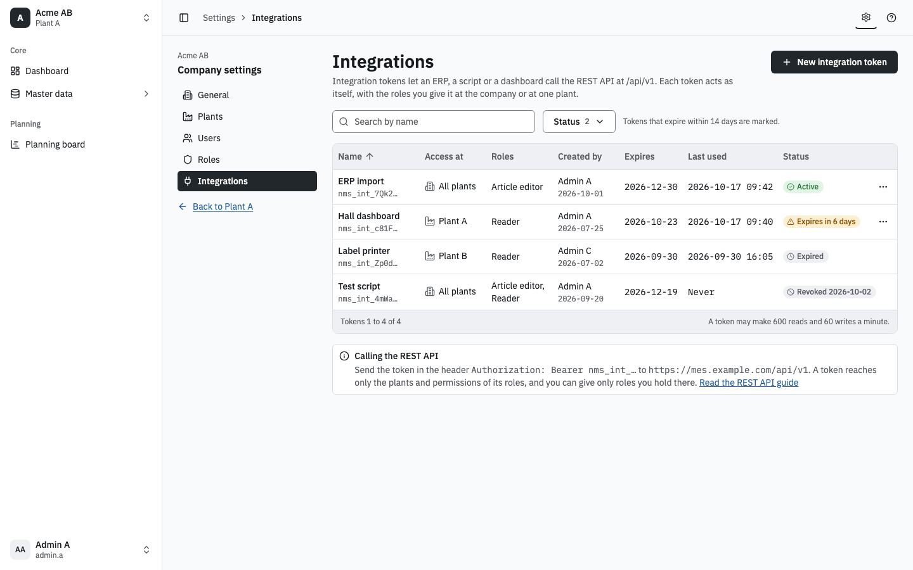

The list at 1440, dark:

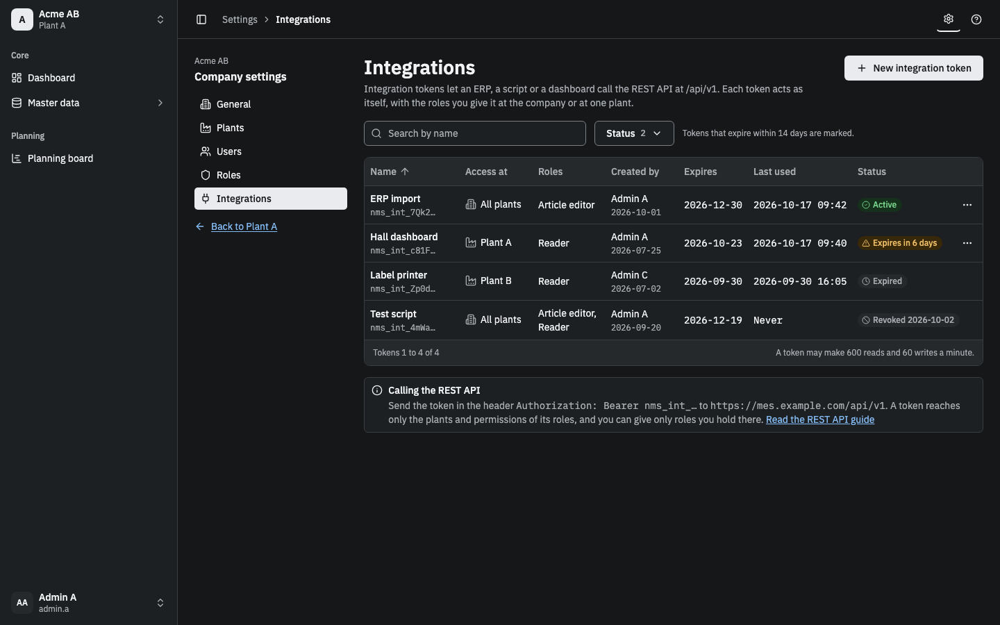

No tokens yet:

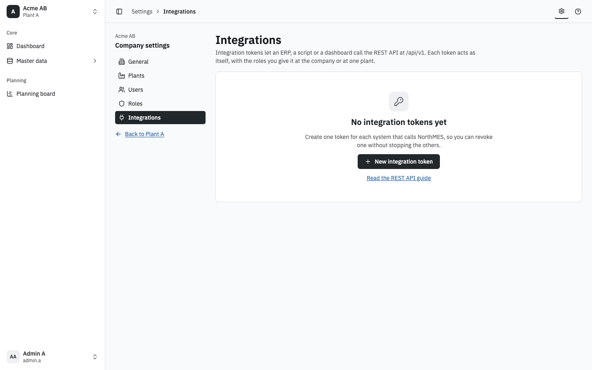

Loading:

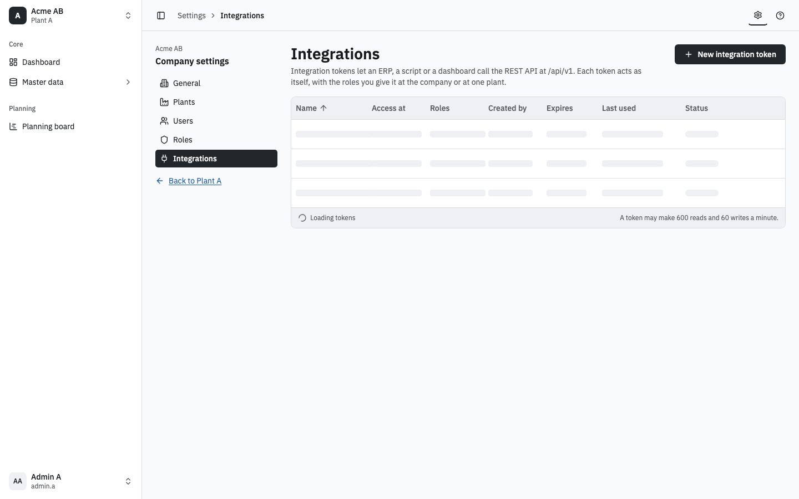

No access, for a user without `core.integration:manage` at the company:

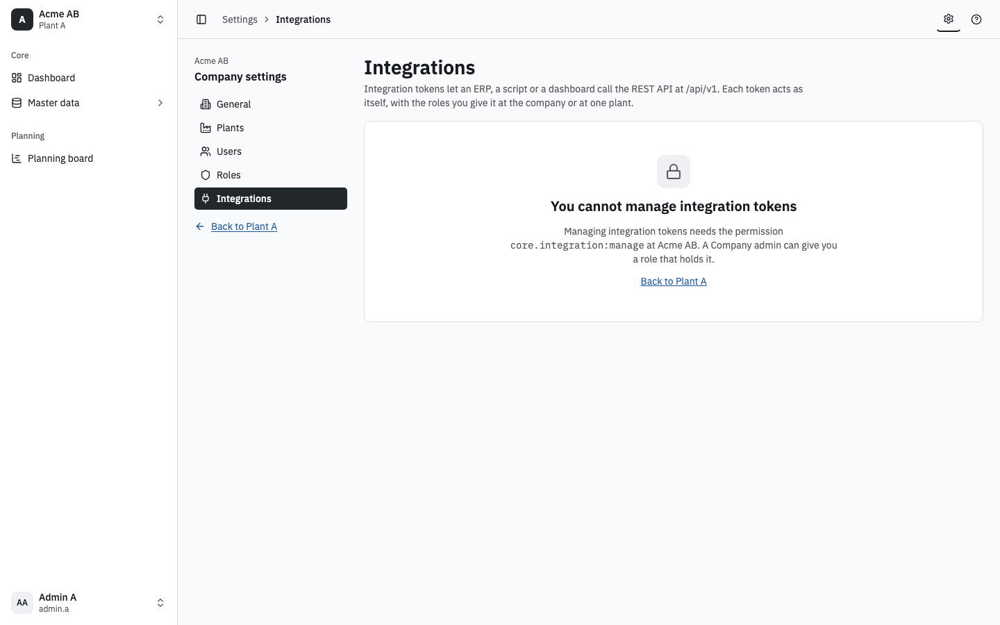

The list at 320, where the table scrolls in its own box:

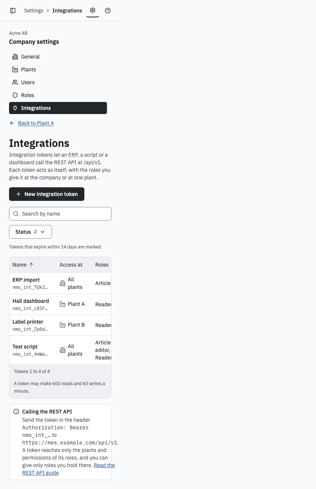

### New integration token

The page at 1440, light:

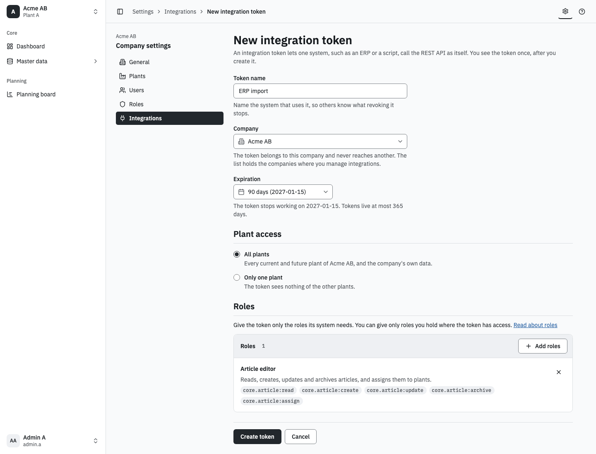

The expiration list open:

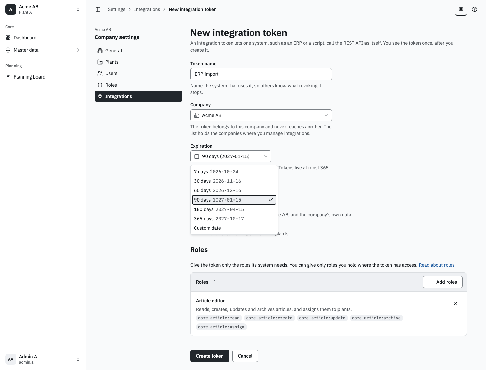

A custom date and one plant:

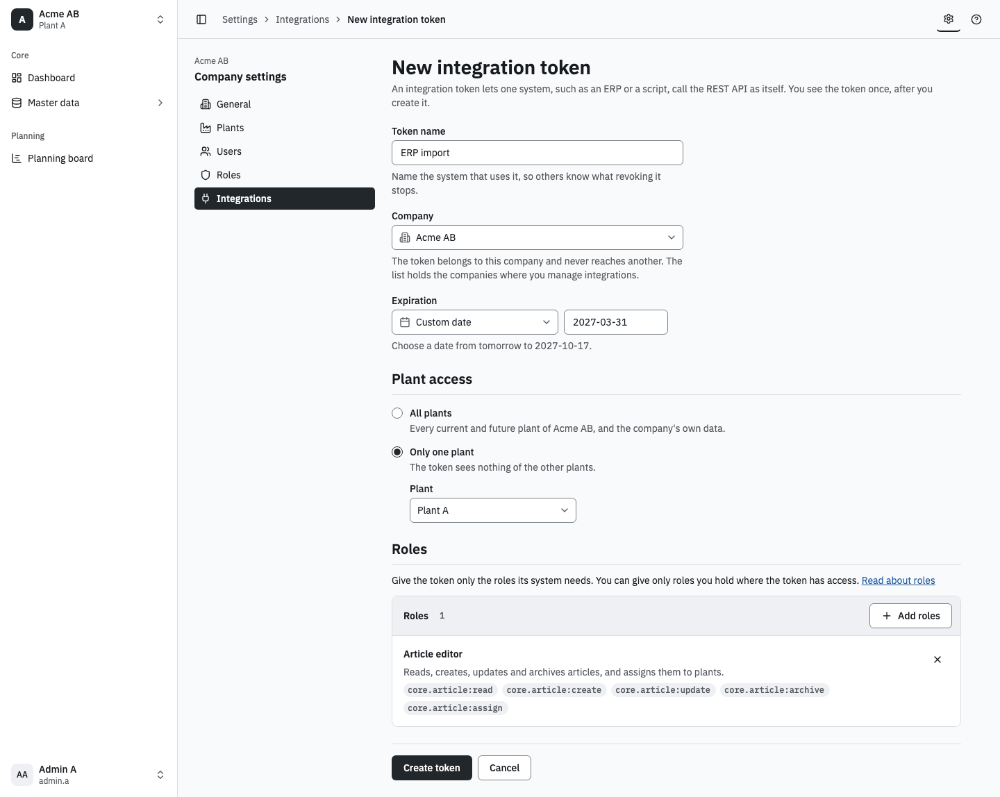

The roles picker open, with Planner disabled because the creator does not hold it:

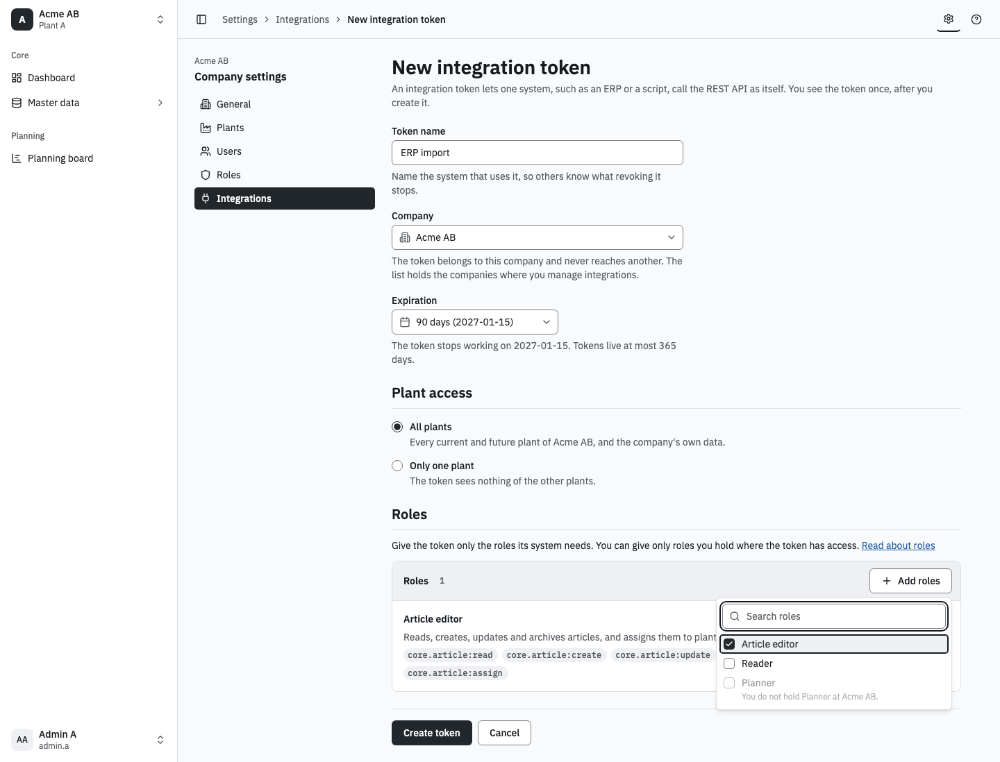

Field errors after Create token with no name and no roles:

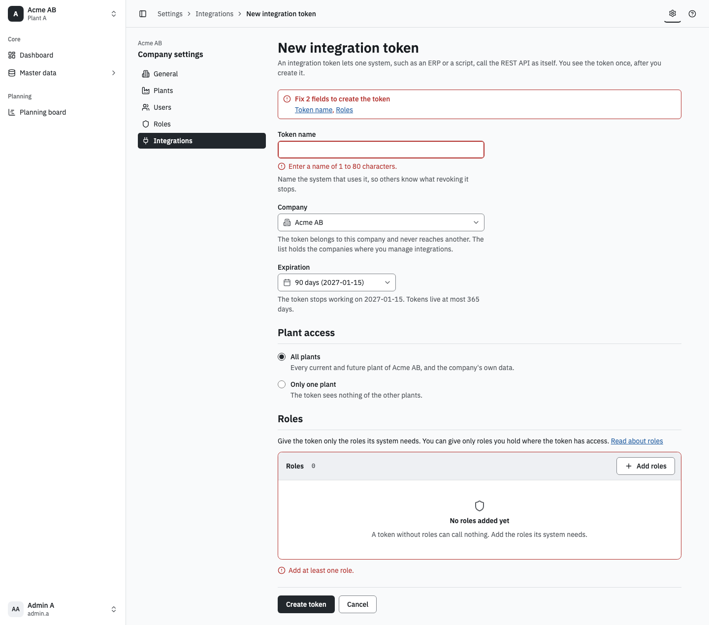

The page at 1440, dark:

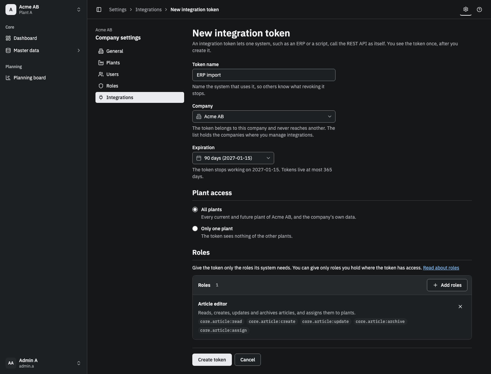

The page at 320:

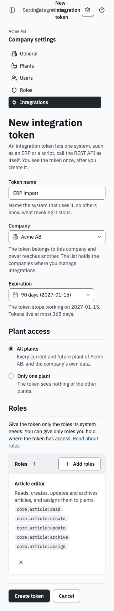

### After create and revoke

The token shown once:

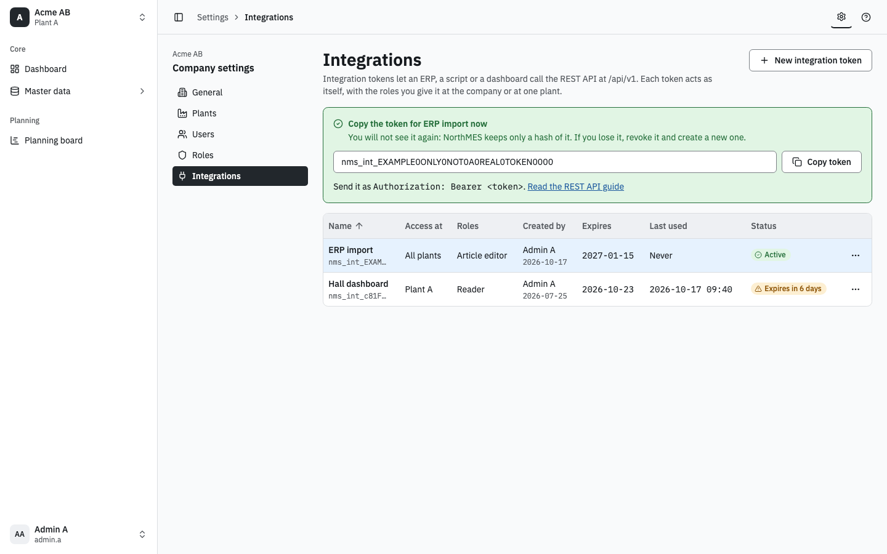

The revoke confirm:

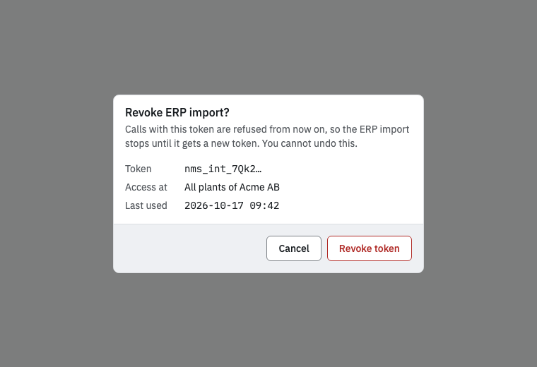

## Build notes

- Routes: `/settings/$companyId/integrations` for the list and `/settings/$companyId/integrations/new` for the New integration token page. The Integrations entry joins core's company settings links after Roles, with the Plug icon, behind `core.integration:manage`.
- Data: the query `coreIntegrationTokens` and the commands `coreCreateIntegrationToken` and `coreRevokeIntegrationToken` of pull request #673. The secret comes only in the create answer. The list page shows it from router state once and never stores it.
- Components from `apps/web/src/ui`: the settings layout of shell-313, DataTable (a real table, where the design draws a grid with table roles), Button, TextField, Select, RadioGroup, Combobox with checkboxes for the roles picker, Alert, StatusBadge and the neutral Badge for permission ids, ConfirmDialog for revoke.
- Status: Active (CircleCheck, success), Expires in N days within 14 days (TriangleAlert, warning), Expired (Clock, neutral) and Revoked with its date (Ban, neutral). Only active and expiring rows have the row menu.
- Times show in plant time, dates as ISO. Token prefixes, dates and times are mono.
- The copy button announces "Copied" through the live region of the banner.

## Known limits

- The token prefix column needs Better Auth to store the key's first characters. Pull request #673 sets `startingCharactersConfig.shouldStore: false`, which is its open question 4.
- At 320 the REST API note's mono strings run past the card, and the design draws the desktop top bar. The build wraps long strings and uses the shell's Navigation sheet below 768 px, as shell-190 decides.
- The Status filter's menu is not drawn.
- The custom date is drawn as an ISO text field, since the design system has no date picker yet.

## Open questions

1. The settings route already names the company. Is Company a select that moves to another company's settings, or plain text?
2. Article editor and Reader are fictional custom roles. The roles picker lists the company's roles, and its order is not decided.
