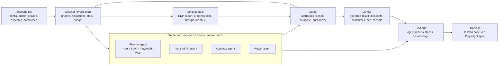

# Simulated users: role agents that use NorthMES through the web

Research note of 2026-10-29 with the maintainer's decisions of the same day at the end. The clock seam gets its own ADR when S1 is shaped; until then this note holds the design.

## The question

Krister asked for a "simulate" end-to-end test: start the application, put a few users on it, each one an agent with a role (planner, plant admin, operator, viewer), and let them use NorthMES through the web portal. One creates orders, one plans, one reports progress. The run starts from a known configuration (machines, calendars, articles, routings, orders) and ends in a result the scenario states up front, so a wrong plan, a lost order or a refused action that should have passed shows up as a failure. Scenarios also carry disruptions: an order paused mid production for a rush order, a machine that goes down, two planners on the same row. The aim is to find issues that scripted specs do not reach.

## Summary

Build it as a scenario harness where language-model agents are the hands and a deterministic verifier is the judge. Each persona is one agent with its own browser, driven through Playwright MCP from the Claude Agent SDK. A director written in plain TypeScript runs the scenario in phases, injects the disruptions, and runs scripted bots for the parts that need no judgment (the ERP import, operator progress ticks). At the end, and at checkpoints, the verifier reads the database and the GraphQL API and compares them with the scenario's expected result and a list of invariants. Agents also write findings (what looked wrong to them), which are triaged, never counted as failures. A run that passes can be harvested into an ordinary Playwright spec, so the regression is guarded for free afterwards.

Two things in the repository shape the design. The planning domain package ([ADR 0057](../adr/0057-scheduling-domain-as-a-pure-package-in-the-planning-module.md)) already holds a scenario with its expected values, the fixture `G1` and `g1.expected.json`, which [18-gantt-timeline.md](18-gantt-timeline.md) describes as coming from one calculator script, and that is the oracle shape this harness needs. And the end-to-end harness already starts a seeded stack and one server per worker on a cloned database, which is the stage. What is missing is the planning API: the backend planning module has one command, `planning.releaseProductionOrder`, and the Gantt, the production orders list and the inventory pages read the fixture `G1` in the web until their API lands; the release orders screen already queries the server. So the harness can be built and proven now on master data and access scenarios, and the planning scenarios run once orders, job orders and the draft reach the server.

The suite never runs on pull requests. It is a nightly or manual job, like the live AI tests of [ADR 0042](../adr/0042-ai-in-tests-mocked-by-default-opt-in-live-runs.md), with a provider-side budget cap and a per-agent cost cap.

## What the repository has today

| Piece | Where | What it gives the harness |
|---|---|---|
| Stage | `e2e/fixtures.ts`, `e2e/global-setup.ts`, `scripts/stack/stack.mjs` | `startStack` starts Postgres from Testcontainers, runs the migrations and the seed; each worker clones the seeded database and spawns `apps/backend/dist/main.js` in role `all` on a free port. The harness does the same once per scenario. |
| Personas | `scripts/stack/seed.mjs` | The dev admin, Company admin at the company, and four users with one role each at plant A: Jonas Holm (Plant admin), Alex Lund (Planner), Anna Berg (Operator, a custom role with two read permissions) and Sara Nyberg (Viewer), every one with a dev-only password. |
| Sign-in | `e2e/fixtures.ts`, `signIn` | Fills the sign-in form; sets `x-forwarded-for` per sign-in because the server refuses more than three sign-ins in ten seconds per client. |
| Oracle shape | `modules/planning/domain/fixtures/gantt/` | `g1.json` (orders, routings, calendars), `g1.master-data.json`, `g1.inventory.json`, `g1.pages.json` and `g1.expected.json`, with tests that keep them in step. `g1.test.ts` says both come from one calculator script, which the repository does not hold. [18-gantt-timeline.md](18-gantt-timeline.md) quotes the expected values case by case, for example GT3, GT4, GT8, GT9 and GT10. |
| Domain functions | `modules/planning/domain/src/` | Pure scheduling functions over plain data, with `now` and the plant zone as arguments ([ADR 0057](../adr/0057-scheduling-domain-as-a-pure-package-in-the-planning-module.md)). |
| Accessibility gate | `e2e/a11y.ts` | `checkA11y` per page state ([ADR 0021](../adr/0021-accessibility-target-wcag-2-2-aa.md)). The harness can run axe on every page an agent lands on. |
| Live AI pattern | [ADR 0042](../adr/0042-ai-in-tests-mocked-by-default-opt-in-live-runs.md) | Opt-in runs, a provider-side credit cap, a key that no pull request workflow can reach, one worker, a soft per-run counter. |
| Eval harness pattern | [ADR 0085](../adr/0085-replay-evals-of-agent-delivery-from-merged-pull-requests-graded-by-their-hidden-tests-pnpm-check-and-a-calibrated-rubric.md) (proposed), [19-replay-eval-suite.md](19-replay-eval-suite.md) | Planned, not built: a private workspace package `evals/`, root scripts, sessions through Claude Code headless, results in a folder outside the repository that an environment variable names. |
| Planning backend | `apps/backend/src/modules/planning/` | One command, `planning.releaseProductionOrder`. No orders, job orders, drafts, locks or autoplan on the server yet. |
| Planning web | `apps/web/src/modules/planning/` | The Gantt, the production orders list and the inventory pages read the fixture `G1` (`gantt-data-g1.ts`) until their API exists; the release orders screen queries the server. |
| Operator station | [09-operator-station.md](09-operator-station.md), [ADR 0033](../adr/0033-online-operator-station-in-the-production-start-module.md) | Not built. Pause mid production needs it, or the connector's progress report. |
| Server clock | `apps/backend/src/` | No clock seam found. The domain takes `now` as an argument, the server reads the real clock. |

## What the field has

Three lines of prior work apply, and each contributes one idea.

**Facebook's WES (Web-Enabled Simulation, 2020).** A community of bots acts on the real platform, isolated from production users. The paper's bots call back-end code rather than the user interface, because that is cheaper and faster, and it uses platform metrics as the oracle. It reports that about a quarter of impactful production bugs were "social bugs" that only appear when users interact, that a community of bots messaging each other was enough to find some of them without realistic user behaviour, that speeding bots up introduces races and flakiness, and that it is the most computationally expensive form of testing Facebook runs. Lesson for NorthMES: use scripted bots through the API for volume and timing, and spend model calls only where a person's judgment is what the test exercises. Source: [WES: Agent-based User Interaction Simulation on Real Infrastructure](https://ar5iv.labs.arxiv.org/html/2004.05363).

**Persona agents for product evaluation (2025 to 2026).** Agent A/B ran 1,000 persona-driven agents on live Amazon pages to rehearse an A/B test; UXAgent generates personas for usability studies. Both are evaluation tools, not functional test frameworks, and their authors call them a complement to human testing. Lesson: a persona prompt gives an agent a goal and a vocabulary, and the output is evidence to triage, not a pass or fail. Sources: [Agent A/B](https://arxiv.org/html/2504.09723v4), [UXAgent](https://dl.acm.org/doi/10.1145/3706599.3719729), [Knightec thesis proposal comparing scripted, free and persona exploration](https://career.knightecgroup.com/jobs/8544339-thesis-can-ai-agents-replace-the-tester-comparing-llm-browser-agents-and-scripted-end-to-end-tests).

**Deterministic simulation testing (Antithesis).** Pass or fail comes from properties: "always" assertions that must hold in every run and "sometimes" assertions that must hold in at least one run across the ensemble, which show whether the runs reach the interesting states at all. Lesson: the harness needs a "sometimes" list (the rush order was actually placed before the paused one at least once, a lock was actually broken at least once), or a green run says nothing. Source: [Antithesis sometimes assertions](https://antithesis.com/docs/best_practices/sometimes_assertions/).

Tooling, as of October 2026:

| Tool | What it is | Fit |
|---|---|---|
| [Playwright MCP](https://playwright.dev/mcp/introduction) (`playwright mcp` in the installed Playwright, also published as `@playwright/mcp`) | A tool server over the accessibility tree: `browser_navigate`, `browser_snapshot`, `browser_click`, `browser_fill_form`, `browser_console_messages`, `browser_network_requests`, verify tools under `--caps=testing`. Options `--isolated`, `--storage-state`, `--headless`, `--save-session`, `--output-dir`, `--snapshot-mode`, `--image-responses omit`, `--secrets`. Every response can carry the Playwright code it ran. | The browser hands. One server process per persona gives each agent its own browser and storage state. |
| [Playwright CLI](https://playwright.dev/docs/getting-started-cli) (`playwright cli` in the installed Playwright, also published as `@playwright/cli`) | The same actions as shell commands with named sessions (`-s=<session>`); snapshots go to files, so less lands in the model's context. Third parties report three to four times fewer tokens than the MCP form on the same task ([itnext](https://itnext.io/why-does-playwright-mcp-use-so-many-tokens-da56b6dbd2db), [morphllm](https://morphllm.com/playwright-mcp)). | The cheaper alternative when the agent runs as a Claude Code session with Bash. Measure both on one scenario before choosing. |
| [Playwright test agents](https://playwright.dev/docs/test-agents) | Planner, generator and healer definitions added with `pnpm exec playwright init-agents --loop=claude`, with a seed spec as the model for generated tests. | Not a simulation, but the harvest step: a passed scenario becomes a spec through the generator, and the healer keeps it alive. |
| [Claude Agent SDK](https://code.claude.com/docs/en/agent-sdk/overview) (`@anthropic-ai/claude-agent-sdk`) | `query()` with `mcpServers`, `allowedTools` (`mcp__playwright__*`), `maxTurns`, `maxBudgetUsd`, `hooks`, `settingSources`, a result message with `total_cost_usd` and a subtype such as `error_max_budget_usd`. | The agent loop per persona. Each query runs its own Claude Code process, so several personas run as several queries. |
| [Magnitude](https://docs.magnitude.run) | Natural-language tests run by a vision agent with its own runner. | Vision costs more and the project's accessibility tree is already the test surface (ADR 0021). Not chosen. |
| [Browser Use](https://agentscamp.com/guides/comparisons/browser-agents-compared-2026), [Stagehand](https://www.stagehand.dev/) | An autonomous Python agent loop; a TypeScript act/extract/observe SDK whose production features sit on Browserbase. | A second runtime or a hosted dependency. Not chosen. |
| [Playwright MCP Orchestrator](https://github.com/mediar-ai/playwright-mcp-orchestrator) | Several agents sharing one Chrome with tab isolation. | Shared state between personas is the opposite of what the harness needs. |

Two measured facts about cost drive the design. Each `browser_snapshot` stays in the agent's context for the rest of its run, so a run of forty steps carries forty snapshots; Playwright's own guidance puts a snapshot at a few hundred tokens, vendors report tens of thousands on dense pages ([Provar on Salesforce pages](https://provar.com/blog/thought-leadership/the-114k-token-problem-why-playwright-mcp-burns-your-ai-coding-agents-control-on-salesforce/)). A screenshot costs far more than a snapshot. Keep images off, keep page snapshots as small as the task allows, and cap each agent in dollars.

## Design

### Principle

The agents decide what to click. They never decide whether the run passed. Pass or fail comes from the verifier, which reads the database as `nm_app` and the GraphQL API with a service identity, compares them with the scenario's expected result, and checks the invariants. An agent's own claim ("I saved the plan") is logged and may be contradicted by the verifier, which is itself a finding: the UI told the user something the system did not do.

### Components

**Scenario file.** One JSON or TypeScript file per scenario under `sim/scenarios/`, in the shape of `g1.json`: plants, calendars, equipment, articles, routings, customer orders and production orders, plus three parts the fixture lacks: the phases with the persona goal per phase, the disruptions with the phase they land in, and the expected end state with the "sometimes" list. The expected part is computed with the domain package's functions wherever they cover the rule, by a generator script that phase 4 adds to the domain package's fixtures (the calculator behind `g1.expected.json` is not in the repository), and hand-written where the rule is a product rule (a refused permission, an audit row).

**Stage.** The director calls `startStack` as `e2e/global-setup.ts` does, clones the seeded database, loads the scenario's master data and orders through the public commands (the same path the ERP connector takes, [ADR 0031](../adr/0031-erp-integration-connector-modules-field-ownership-and-pending-changes.md)), and spawns the built server in role `all` on a free port with `NORTHMES_TRUSTED_PROXY_HOPS=1`, so that a distinct `x-forwarded-for` per sign-in passes the throttle of three sign-ins in ten seconds per client, as `e2e/fixtures.ts` does. One stage per scenario run; nothing is shared between runs.

**Personas.** One `query()` per persona with a system prompt that holds the role, the goal of the current phase, the plant and the rules of the game (use only the web, report what looks wrong, never guess a value that the page does not show, stop when the goal is reached or impossible). Each persona gets its own Playwright MCP server over stdio with `--isolated --headless --storage-state <file> --save-session --output-dir <run>/<persona> --image-responses omit`, `allowedTools` holds only `mcp__playwright__*`, `settingSources` is `[]` and `strictMcpConfig` is `true`, so the repository's own settings, skills and MCP servers stay out of the persona's session. The storage state comes from a scripted sign-in that the director runs with plain Playwright before the agent starts, with its own `x-forwarded-for` value, so no password ever enters a model's context, and `--secrets` masks the values if one leaks into a page. Each persona has `maxTurns` and `maxBudgetUsd`; the result's `subtype` tells the director whether the budget, the turn limit or the goal ended the run.

**Director.** Plain TypeScript, no model. It runs the phases in order, waits for the personas of a phase to finish, injects the disruption (a rush order through the import command, a calendar deviation through core's command, a machine down), advances the simulated clock when a clock seam exists, and starts the next phase. It writes one event log per run: phase starts, agent results with cost, bot actions, disruption instants.

**Scripted bots.** Everything with no judgment in it runs as code through GraphQL or the public commands: the ERP import that creates the orders, the operator ticks that report quantities on a schedule, the second planner that holds a lock. This is the WES lesson: bots through the back end are cheap and deterministic, and they create the multi-user situations that the judgment agents then meet in the UI.

**Verifier.** Runs at each checkpoint the scenario names and at the end. Three lists:

- Expected: the planned start and end of each job order, the order status, the stock projection, compared with the expected file with the tolerances the domain tests use.
- Always: no two job orders overlap on one equipment; no row starts before its release; a frozen row did not move; a report never changed a row that carries reports; an operator saw no planner action (the persona's log has no click on one, and the API refused any attempt); every write has its audit row ([ADR 0013](../adr/0013-audit-trail-written-in-the-command-transaction.md)); no GraphQL error with code `internal`; no browser console error; axe found no WCAG 2.2 AA violation on any page state an agent reached.
- Sometimes, across the run set: a rush order was placed before an already planned one; a cascade moved a successor; a lock was broken and the other planner was told; a conflict was shown and resolved.

**Findings.** Each agent ends with a structured list, through the SDK's structured output: what it tried, what the page said, what felt wrong, with the step number. The director joins them with the verifier's failures, the session logs (`session.md` per persona, with the Playwright code of every action), the Playwright trace on failure and the cost per persona. A failure of the expected list or the always list fails the run. An agent finding is a candidate issue for Krister to triage.

**Harvest.** The session log holds the Playwright code of every action the agent took. A passed scenario goes through Playwright's generator agent into a spec under `e2e/sim/`, with the verifier's expected values as its assertions, and the healer keeps it alive when the UI changes. The expensive run then happens once per scenario version, and the cheap spec runs in `ci / e2e`.

### Time

Most scenarios need a clock the run controls: the planner plans on Monday, the rush order arrives Wednesday morning, the machine goes down Thursday. The domain takes `now` as an argument, the server does not. Two options:

1. A clock seam in the server, set by an environment variable or a dev-only command, that every `now` reads. The simulation sets it per phase. This is a product change with its own ADR, because a settable clock must be impossible in production (the same rule as the dev users' ids, which a production boot refuses).
2. Scenarios in real time with short durations: operations of minutes, calendars that match the wall clock of the run, phases that wait. No product change, but a run takes as long as the scenario, and DST and week boundaries cannot be reached.

Option 1 is the one to plan for; option 2 is enough for the first master data and access scenarios, which carry no time.

### Determinism and the pass rule

Model agents are not deterministic, and the WES paper notes that even scripted bots become flaky when they run faster than people. The harness treats this as the eval suite of [ADR 0085](../adr/0085-replay-evals-of-agent-delivery-from-merged-pull-requests-graded-by-their-hidden-tests-pnpm-check-and-a-calibrated-rubric.md) does: a scenario runs k times (three in the first runs), the expected and always lists must hold in every run that reached the end, the sometimes list must hold at least once across the k runs, and a persona that stopped on its budget or turn limit before the goal is reported as "did not finish" rather than as a failure. A scenario that cannot be finished by the agents in three of three runs is a finding about the UI or the prompt, and it is tried once with a stronger model before the prompt is changed.

### Models and cost

Personas run on the model that is cheapest at following a goal through a page, Sonnet or Haiku in the Claude 5 family, with the planner on Sonnet. Findings triage runs on Opus. The cost per run is unknown until the first scenario is measured; the plan records the measurement before a second scenario is written. The first measurement compares the MCP form and the CLI form of the same persona on the same scenario.

### Where it lives and runs

- A private workspace package `sim/` (`@northmes/sim`), not published, nothing in the product imports it, listed in `pnpm-workspace.yaml`. Root scripts `pnpm sim` (one scenario, k runs) and `pnpm sim:report`.
- One new dependency, `@anthropic-ai/claude-agent-sdk`, in its own pull request at a version older than Renovate's window. The Playwright MCP server and the Playwright CLI ship in the installed `playwright` 1.63 (`pnpm exec playwright mcp`, `pnpm exec playwright cli`, `pnpm exec playwright init-agents`), with the same options as the `@playwright/mcp` package, whose releases pin Playwright alphas and are therefore not brought in. `.claude/settings.json` denies `npx`, so every command runs through `pnpm exec`.
- The key is the eval API key of ADR 0085 with its monthly credit limit, or a second key with the same shape. No pull request workflow can reach it. Runs start by hand or on a schedule, never in `pnpm check`, `ci / gate` or a pull request.
- Results go to the folder that the environment variable of [19-replay-eval-suite.md](19-replay-eval-suite.md) names, in the maintainer's private repository as ADR 0085 requires; a finding that holds becomes a GitHub issue with the session log excerpt and the trace.
- The product's own AI stays mocked (ADR 0042): the simulation's models are test infrastructure, the stage's company has no provider configured, and a scenario that exercises the planning assistant would use the stub provider server of ADR 0042, not a live one.

### Security notes

- The personas sign in as the seed's dev users, whose ids a production boot refuses, so the harness can never run against a real installation.
- Agents hold no secret: sign-in happens in code, the storage state file lives in the run folder and is deleted with it.
- The verifier reads as `nm_app` with the row-level security scopes of the plant, never as `nm_owner`.
- Agent findings are untrusted text: they are written to the findings file and read by a person, never fed to a command.

## Scenarios

The first set, in build order. Each names what it needs.

| Id | Scenario | Personas and bots | Expected and always | Needs |
|---|---|---|---|---|
| S0 | Master data and access: the plant admin creates an article group, three articles and a routing; the planner opens them; the viewer tries to edit; the operator tries the people pages | admin, planner, viewer, operator | The rows exist with the entered values and an audit row each; the viewer and the operator were refused on the server, and the pages showed the refusal state, not an error | nothing new; proves the harness, the sign-in, the cost and the findings |
| S1 | The G1 plan: the orders of `g1.json` are imported; the planner places every row by hand on the board and saves | planner; import bot | The job orders match `g1.expected.json`; no overlap; the draft is empty after save | planning API: orders, job orders, draft, save |
| S2 | Rush order: S1, then a rush order arrives for the same article with a deadline before `1001`; the planner fits it in | planner; import bot for the rush order | The rush order is placed first and `1001` moved by the cascade rules; sometimes: the planner used "Plan this order" | S1, the clock seam for the arrival instant |
| S3 | Machine down: S1, then CNC1 gets a non-working deviation on Thursday; the planner moves the affected rows | planner; admin sets the deviation | No row on CNC1 inside the deviation; the moved rows still respect release and lead time | S1, calendar deviations on the server |
| S4 | Pause mid production: S2 with the operator reporting on `1001.10` when the rush order arrives; the planner pauses `1001.10` and starts the rush order on the same machine | planner, operator; progress bot | The reported quantity is kept; the remainder is planned after the rush order; the frozen rule holds for the reported part | S2, the operator station or the connector's progress report, the split rule (plan 09 lists splitting the remainder as later) |
| S5 | Two planners: two planner personas on the same order; one holds the lock | two planners | The second planner was told the row is locked; after the first saves, the second sees the new placement without reload; sometimes: a lock was broken | S1, drafts and soft locks, realtime |
| S6 | Free exploration: each persona gets only its role and a goal of its own choosing for twenty turns | all | No always violation; findings only | S0 |

## Phases

1. Harness on S0 (now). The package, the stage, one persona, the sign-in by code, the verifier with the audit and refusal checks, the findings file, the cost measurement, MCP against CLI. Decision point: cost per persona and whether the agent can reach a goal on the current UI without hints.
2. Four personas on S0 and S6. The director, concurrent agents, the always list with axe and console, the first findings triage.
3. The harvest of S0 into `e2e/sim/`.
4. S1 when the planning API lands. The expected list from the domain package, the clock seam ADR, scripted import bot.
5. S2, S3, S5 as their server features land. S4 after the station.
6. Nightly schedule with k = 3 and a monthly cost report.

## Decisions

Krister decided these on 2026-10-29.

1. Clock seam: a settable server clock behind a production refusal, with its own ADR, written when S1 is shaped. S2, S3 and S5 need dated instants and plan 18's expected values are written against fixed dates; real-time scenarios cannot reach a week boundary or a DST change. S0 and S6 carry no time and do not wait for it.
2. Package placement: a new `sim/` package, apart from the planned `evals/` package of plan 19. The two share the key, the result folder outside the repository and the headless session code through one small shared folder, and keep their dependencies and tests apart.
3. Agent runtime: the Agent SDK, brought in its own pull request. Plan 19 runs the evals through `claude` headless so that suite adds no model SDK dependency; the simulation takes that dependency, because it needs concurrent personas, `maxBudgetUsd` and `maxTurns` per persona with the result subtype, `hooks` for the run log, structured output for the findings, `settingSources: []` and `strictMcpConfig: true`, which with `claude -p` would be one process per persona to supervise by hand.
4. Findings: a GitHub issue per finding that holds, written by Krister after triage. The raw run output (session logs, traces, costs) stays in the private result folder of plan 19, because it carries page snapshots and untrusted agent text.
5. S4's split remainder is not release 1 scope: plan 09 lists it as later and the station is on the cut list. S4 stays as the scenario for the pause and the frozen rule once the station exists, and gets the split when that feature is scheduled.

## Sources

- [WES: Agent-based User Interaction Simulation on Real Infrastructure](https://ar5iv.labs.arxiv.org/html/2004.05363)
- [Agent A/B: Automated and Scalable Web A/B Testing with Interactive LLM Agents](https://arxiv.org/html/2504.09723v4)
- [UXAgent: An LLM Agent-Based Usability Testing Framework for Web Design](https://dl.acm.org/doi/10.1145/3706599.3719729)
- [Knightec thesis proposal: LLM browser agents against scripted end-to-end tests](https://career.knightecgroup.com/jobs/8544339-thesis-can-ai-agents-replace-the-tester-comparing-llm-browser-agents-and-scripted-end-to-end-tests)
- [Antithesis: sometimes assertions](https://antithesis.com/docs/best_practices/sometimes_assertions/)
- [Playwright MCP introduction](https://playwright.dev/mcp/introduction) and the [Playwright MCP README options](https://github.com/microsoft/playwright-mcp/blob/main/README.md)
- [Playwright CLI getting started](https://playwright.dev/docs/getting-started-cli)
- [Playwright test agents](https://playwright.dev/docs/test-agents)
- [Claude Agent SDK overview](https://code.claude.com/docs/en/agent-sdk/overview), [MCP in the Agent SDK](https://code.claude.com/docs/en/agent-sdk/mcp), [TypeScript reference](https://code.claude.com/docs/en/agent-sdk/typescript)
- [Why does Playwright MCP use so many tokens](https://itnext.io/why-does-playwright-mcp-use-so-many-tokens-da56b6dbd2db), [Playwright MCP setup and cost](https://morphllm.com/playwright-mcp), [The 114k token problem](https://provar.com/blog/thought-leadership/the-114k-token-problem-why-playwright-mcp-burns-your-ai-coding-agents-control-on-salesforce/)
- [Magnitude docs](https://docs.magnitude.run), [Browser agents compared 2026](https://agentscamp.com/guides/comparisons/browser-agents-compared-2026), [Stagehand](https://www.stagehand.dev/), [Playwright MCP Orchestrator](https://github.com/mediar-ai/playwright-mcp-orchestrator)
